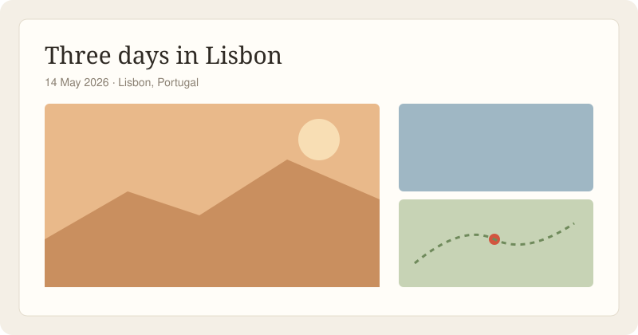

# Getting started

Lantern builds a photo journal from a folder: every Markdown file is a trip, and every picture beside it is part of that trip's story.



## Installing

You need Node 20 or newer. Make a new journal with:

```sh
npm create lantern@latest my-journal
cd my-journal
npm run dev
```

Then open <http://localhost:4173> and you'll see the sample trip.

> [!TIP]
> Already have a folder of photos? Run `lantern import ~/Pictures/Lisbon` and Lantern writes the trip page for you.

## Your first trip

Each trip is one Markdown file in `trips/`. The front matter says where and when; the body is yours.

| Field   | Required | What it does                         |
| ------- | :------: | ------------------------------------ |
| `title` | yes      | The trip's name, shown on its card   |
| `date`  | yes      | When it started (`2026-05-14`)       |
| `where` | no       | A place name, pinned on the map      |
| `cover` | no       | The picture on the trip's card       |

Write the way you'd write a letter. Lantern lays out the photos between your paragraphs, in the order you mention them.

- [x] Install Lantern
- [x] Make a journal
- [ ] Write about a trip
- [ ] [Deploy it](deploying.md)

## Next steps

Read [Writing a trip](writing-a-trip.md) for the details, or pick a look in [Themes](themes.md).
