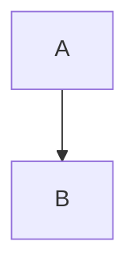

# Heading one

Some *emphasis*, **strong**, `code`, ~~gone~~, a [link](https://example.com "t"),
an autolink <https://tinyjs.app>, and a [relative one](other.md#part).
Bad links stay inert: [js](javascript:alert(1)) and .

> [!NOTE]
> An alert with **markup**.

> [!WARNING]
> Careful.

- one
- two
  - nested
- [ ] todo
- [x] done

1. first
2. second

| Left | Centre | Right |
|:-----|:------:|------:|
| a    | b      | c     |
| `x|y` | **z** | 3 |

```js
const a = 1; // a comment
function f(x) { return `t ${x}`; }
```



Inline math $e^{i\pi} + 1 = 0$ and a block:

$$
\int_0^1 x\,dx
$$

:tada: :+1: :not_a_code:

Footnote here[^1] and again[^note].

[^1]: The first.
[^note]: Named.

<div align="center">

**Centred markdown**

</div>

<script>alert('no')</script>


---

Final paragraph with a hard  
break and a trailing \
backslash break.
